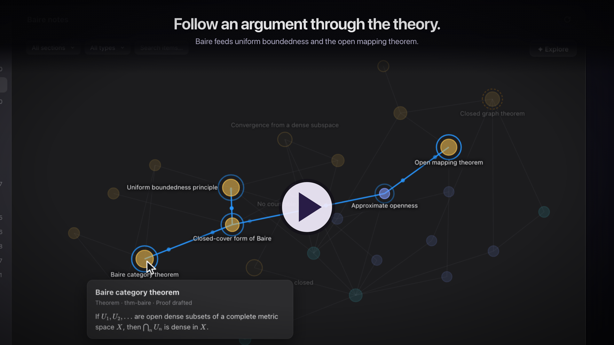
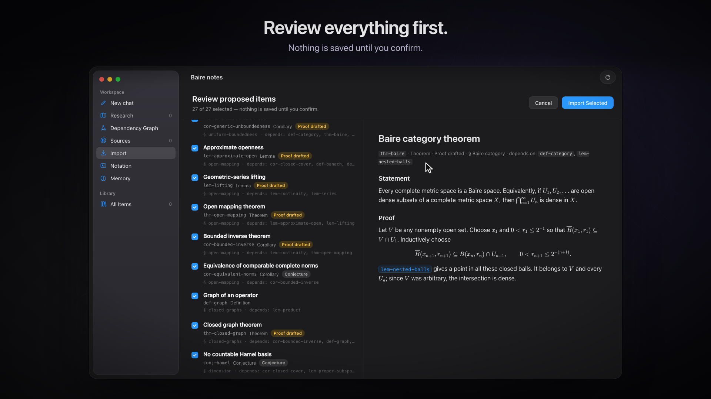
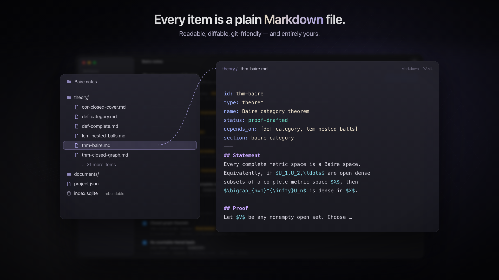
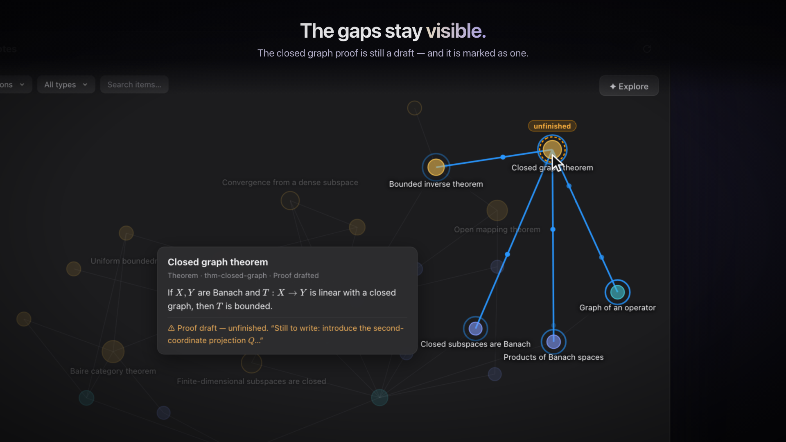
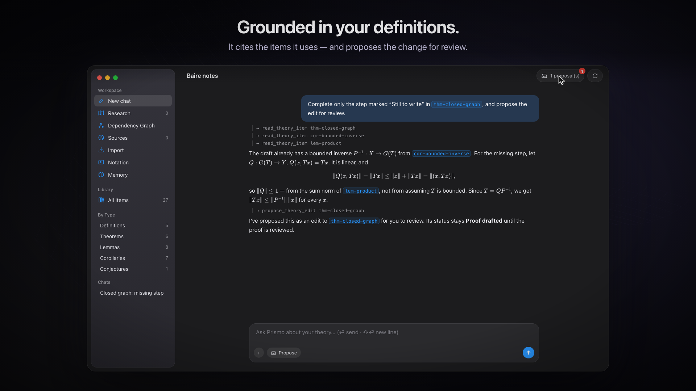
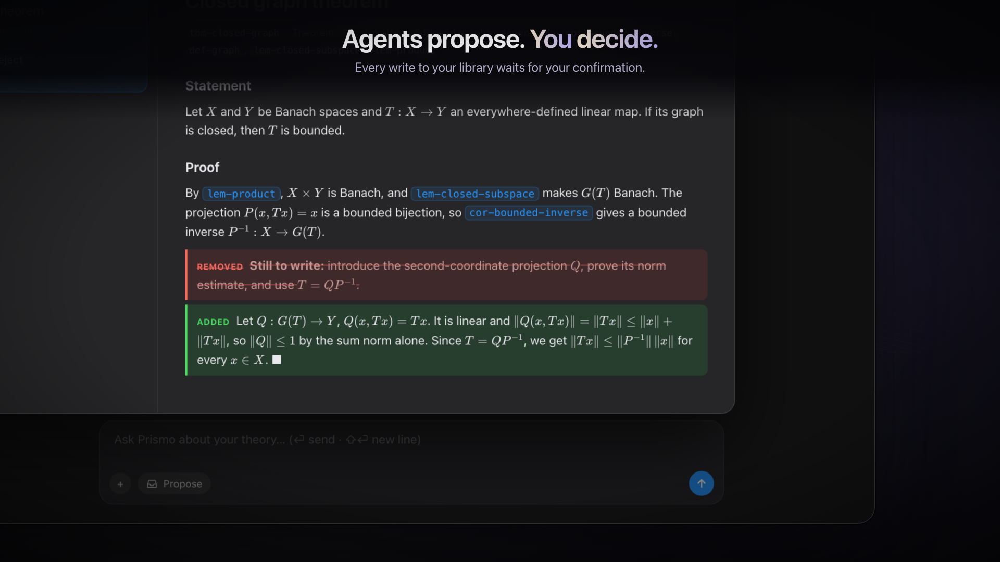

<p align="center">
  
</p>

<h1 align="center">Manifield</h1>

<p align="center">
  A macOS workbench for mathematical research, readable by you and by AI agents.
</p>

Manifield keeps a mathematical theory you are developing as a folder of plain Markdown files: definitions, lemmas, theorems, conjectures and figures, one statement per file. Through the app you read them rendered, see the dependency graph, and track what evidence stands behind each statement. Optional AI assistants work from your own definitions and notation, and everything they want to change arrives as a proposal you can accept, reject or use auto mode.

It is free software under the GPLv3, written by one person.

<p align="center">
  <a href="docs/media/manifield-demo.mp4"></a>
  <br>
  <sub><b>92-second walkthrough</b> (<a href="docs/media/manifield-demo.mp4">MP4</a>). The interface is an animated simulation, not a screen recording, and the import wait is shortened. The mathematics on screen is the real <a href="examples/baire-category/">Baire example</a> in this repository.</sub>
</p>

## Why

Mathematicians write in LaTeX and on paper. AI agents such as Claude Code and Codex work in folders of plain-text files. More and more people use those agents on real mathematics, and then end up opening Markdown files one at a time to see what happened. Manifield gives the two a shared place: the theory lives in files an agent can read and write, and the mathematician browses the same files as a library and a graph.

It is meant to be useful **without any AI at all**. Browsing, search, the graph, notation and macros, writing items by hand and keeping PDFs all work with no model configured.

## What it does

<table>
  <tr>
    <td width="50%"><br><sub><b>Import LaTeX, review before saving.</b> Your <code>.tex</code> is split into items with dependencies.</sub></td>
    <td width="50%"><br><sub><b>Every item is a plain Markdown file</b> with a little YAML: id, type, status, 
    <code>depends_on</code>, section.</sub></td>
  </tr>
  <tr>
    <td><br><sub><b>Dependency graph.</b> Colour by family, filter by section, type and status, hover for the rendered statement.</sub></td>
    <td><br><sub><b>Gaps stay visible.</b> An unfinished proof is a <i>Proof drafted</i> item, and its prerequisites are one click away.</sub></td>
  </tr>
  <tr>
    <td><br><sub><b>An assistant grounded in your project.</b> It searches and reads your items before answering, and cites them by id.</sub></td>
    <td><br><sub><b>Agents propose, you decide.</b> Edits arrive as diffs. Accepting a proof does not mark it correct.</sub></td>
  </tr>
</table>

<sub>Stills from the simulated walkthrough above. They match the app's layout, labels and colours, with some simplification.</sub>

- **A library for your theory.** Items are grouped by section, statements render with KaTeX and your own macros, and there is full-text search. Notation and conventions live in their own file, and PDFs you keep with the project open in a built-in viewer. Adding a PDF makes no model calls.
- **Trust levels, never just "correct".** Every statement records what evidence exists. See below.
- **LaTeX import with review.** The Organizer splits a `.tex` file into definitions, results and conjectures, with dependencies and sections, and harvests your `\newcommand`s. You review every proposed item first.
- **Chat grounded in your project.** The assistant (called Prismo in the app) has tools to search and read your items, notation and kept documents. It has four modes: *Ask* is read-only, *Propose* (the default) turns every edit into a proposal, *Plan* drafts a research target, and *Auto* edits without asking.
- **Computational checks with a paper trail.** Python with networkx, sympy and numpy runs in a sandbox with no network and a hard timeout. Every run keeps its script and output next to the claim it supports.
- **Experimental:** a prover/reviewer loop (the reviewer is prompted to hunt for flaws and re-read citations), multi-step research programs run by a director agent, and an explorer that suggests conjectures.
- **Literature.** You can import a book or paper as a citable source with its own searchable full text. Agents read full texts only with your permission, through capped, search-first tools.
- **Sharing.** *File → Export as Package…* zips the project's theory without your chats or run state.

## How it works

### A project is a folder

```
MyProject/
  project.json        name and format version
  notation.md         notation and conventions, always in the agent's context
  macros.tex          your LaTeX macros, used when rendering
  memory.md           research memory: goals, strategies tried, next steps
  theory/<id>.md      one item per file
  figures/<id>.png    a figure item's image (and the script that drew it)
  documents/<slug>/   files kept with the project: original PDF or .tex, extracted text
  artifacts/          scripts and outputs behind computational claims
  sessions/           chat transcripts
  graph.json          derived dependency edges
  index.sqlite        derived search index
```

An item looks like this ([from the example](examples/baire-category/baire-notes/theory/thm-closed-graph.md)):

```markdown
---
id: thm-closed-graph
type: theorem
name: Closed graph theorem
status: proof-drafted
depends_on: [def-graph-of-an-operator, lem-products-of-banach-spaces, lem-closed-subspaces-are-banach, cor-bounded-inverse]
section: closed-graphs
---
## Statement
Let $X$ and $Y$ be Banach spaces and let $T:X\to Y$ be an everywhere-defined linear map. …

## Proof
By Lemma~\ref{lem:product}, $X\times Y$ is Banach. …

**Still to write:** introduce the second-coordinate projection $Q:G(T)\to Y$, …
```

The search index and the graph are derived from the files and can be rebuilt at any time. So a project works with git, with any text editor, and with any agent that can write Markdown. Claude Code or Codex can work in the same folder; use the toolbar's reload button to pick up their edits (see the limitations below).

### Trust levels

| Status | Meaning | Who can set it |
| --- | --- | --- |
| Conjecture | Stated, no evidence yet | you or an agent |
| Tested | Checked on examples or by computation, with the script kept | you or an agent |
| Proof drafted | A written proof exists | you or an agent |
| Review found no errors | An adversarial review did not find a flaw | you or an agent |
| Human approved | You checked it | **only you** |
| Cited literature | An established result taken from a reference | **only you** |
| Formally verified | Checked by a proof assistant | **only you** |

The best an AI review can give is *Review found no errors*, which is a weaker claim than "correct". When you downgrade a result, Manifield offers to reset everything that depends on it and claims review or approval.

### Your keys, your machine

Bring an API key for Anthropic, OpenAI, Google Gemini, xAI, Z.ai or NVIDIA (kept in the macOS Keychain), or sign in with a ChatGPT account through Codex. Requests go straight from your Mac to the provider you chose; there is no Manifield server in between. The model sees whatever context is sent to it, so this is not private or offline inference.

Manifield's own logs and diagnostics never contain project content: no statements, proofs, prompts or model output. Bug reports are sent only when you press Send, and the form shows exactly what will be sent. The app checks `updates.manifield.net` for updates, and you can turn that off in Settings.

More detail on each part (figures, kept documents, the prover, research programs, rendering, security) is in [docs/how-it-works.md](docs/how-it-works.md).

## Try it

**Install.** Download the signed and notarized DMG from the [releases page](https://github.com/stanislaw13/manifield-releases/releases). It needs macOS 15 or later and runs on Apple silicon and Intel Macs.

**Open the example.** Clone this repository, then in Manifield choose **Open Project…** and pick [`examples/baire-category/baire-notes`](examples/baire-category/). It holds 27 items on Baire category and the three big theorems of functional analysis, with three unfinished proofs and one notebook conjecture. You don't need a model to browse it. [Its README](examples/baire-category/README.md) suggests what to look at, gives a prompt for closing one of the gaps, and explains how to redo the import from the included `.tex` file.

**Use your own notes.** **New Project…**, then **Import → Import into the library** and choose a `.tex` file. That step needs an AI provider (Settings → AI Providers). Or write items by hand with **New Item**.

**Build from source.** You need Xcode 26 and [XcodeGen](https://github.com/yonaskolb/XcodeGen):

```bash
git clone https://github.com/stanislaw13/manifield.git
cd manifield
xcodegen generate
open Manifield.xcodeproj
```

In Xcode, choose your own team under *Signing & Capabilities*, then run the **Manifield** scheme. [CONTRIBUTING.md](CONTRIBUTING.md) covers the code layout, tests and a headless build.

## Known limitations

- **macOS only.** The app is SwiftUI with web views for rendering.
- **The LaTeX import is imperfect.** References across sections can get the wrong ids, so dependencies dangle. The importer may mark cited results *Human approved*. `\ref` and `\cite` render as label keys, not links. Check dependencies and statuses after importing; the example's README lists what had to be fixed by hand.
- **Outside agents' edits.** New files and atomic saves show up live. In-place overwrites don't, so press reload. A file with broken frontmatter is skipped without a visible warning.
- **AI cost is not well understood.** Research programs have used hundreds of thousands of tokens on small problems, mostly input. Set limits under Settings → Limits. The app limits were not tested properly yet. Do not rely only on them.
- **The prover can only be reached inside a research program** for now.
- **No proof assistant integration yet.** *Formally verified* is a status you set by hand. A Lean adapter is planned; the prover already has a verifier interface for it.
- **Auto mode** has had much less testing than Propose mode.

## Contributing

Issues are welcome, and the most useful are reports of where it breaks on your own mathematics. That includes LaTeX that doesn't render, an import that gets the structure wrong, a graph that misleads, or a status that claims more than the evidence. Code contributions are welcome too; see [CONTRIBUTING.md](CONTRIBUTING.md).

Some questions are open, and opinions are welcome:

- Should the file format become a documented, versioned spec that other tools can read and write?
- Should outside agents go through Manifield's tools (with the same proposal and status rules), or keep writing raw files?
- What is the smallest useful version for a mathematician who doesn't want AI involved at all?

## License

Manifield is free software under the [GNU General Public License v3.0](LICENSE). Copyright © 2026 Stanisław Michalik.

Third-party components (KaTeX, marked, DOMPurify, d3-force, SwiftMath and its fonts, Sparkle) keep their own licences; see [THIRD_PARTY_NOTICES.md](THIRD_PARTY_NOTICES.md).
